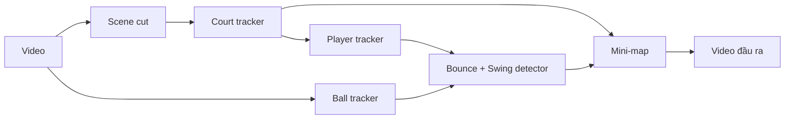

# Tennis Analysis

Phân tích video tennis broadcast: nhận diện sân, người chơi, bóng, điểm bóng nảy và cú đánh, hiển thị mini-map top-down.

<!-- Thay bằng GIF demo của bạn: -->
<!--  -->

## Tính năng

- **Sân**: KeypointRCNN lấy 14 keypoint, tinh chỉnh bằng CV cổ điển (Hough), kiểm tra hình học có đúng là sân; bám theo camera bằng optical flow, detect lại ở thread nền khi cần.
- **Người chơi**: YOLO-pose trên vùng crop quanh sân, `PlayerMemory` giữ đúng 1 người mỗi nửa sân.
- **Bóng**: tìm cục bộ quanh vị trí cũ (ROI), fallback quét toàn frame.
- **Bóng nảy**: phát hiện từ quỹ đạo, loại các "nảy giả" do cú đánh.
- **Cú vung vợt**: từ chuyển động cổ tay so với thân (YOLO-pose keypoint).
- **Chuyển cảnh**: cut / dissolve / mất sân, tự reset các tracker.
- **Mini-map**: vị trí người, bóng, dấu X điểm nảy, ký hiệu HIT.
- Tuỳ chọn tăng tốc bằng **TensorRT FP16**.

## Pipeline



## Cài đặt

```bash
git clone https://github.com/<ten-ban>/tennis-analysis.git
cd tennis-analysis
python -m venv .venv && source .venv/bin/activate   # Windows: .venv\Scripts\activate
pip install -r requirements.txt
```

Cài `torch` đúng bản CUDA của máy theo hướng dẫn tại pytorch.org. Tải weights theo [weights/README.md](weights/README.md).

## Chạy

```bash
python main.py --input path/to/video.mp4
python main.py --input video.mp4 --output out.mp4 --no-preview --max-frames 500
```

Phím `q` trong cửa sổ preview để thoát. Đặt `DEBUG_MODE = True` trong `config.py` để xem thêm box phụ và log lý do bỏ từng lần nảy.

## Cấu hình

Mọi hằng số nằm trong `config.py`, có chú thích hướng chỉnh. Hay dùng nhất:

| Tham số | Ý nghĩa |
|---------|---------|
| `BALL_LOCAL_CONF` / `BALL_GLOBAL_CONF` | ngưỡng tin cậy bóng |
| `BOUNCE_MIN_DROP_PX`, `BOUNCE_MIN_DVY_PX` | độ nhạy phát hiện nảy |
| `SWING_SPEED_H_PER_S` | ngưỡng tốc độ cổ tay tính là vung vợt |
| `HIT_SIDE_EXCL_S` | thời gian loại nảy ở nửa sân người vừa đánh |

## Tăng tốc bằng TensorRT (tuỳ chọn)

Cần GPU NVIDIA và `pip install tensorrt`.

1. `python measure_person_crop.py <video>` để đo kích thước crop, điền `PERSON_ENGINE_IMGSZ` trong `config.py`.
2. Chỉnh các cờ `EXPORT_*` trong `export_engines.py`, chạy `python export_engines.py`.
3. Bật `USE_TENSORRT_BALL`, `USE_TENSORRT_PERSON`, `USE_BALL_LOCAL_ENGINE` trong `config.py`.

Engine gắn với đúng GPU và phiên bản TensorRT đã export; đổi máy thì export lại.

## Hạn chế đã biết

- Thiết kế cho camera broadcast nhìn từ sau baseline.
- Model bóng đôi khi nhầm chấm trắng nhỏ trên vạch sân thành bóng.
- Các ngưỡng bounce/swing chỉnh theo video thử nghiệm, video khác có thể cần chỉnh lại.

## Credits

[Ultralytics YOLO](https://github.com/ultralytics/ultralytics) (AGPL-3.0), [torchvision](https://github.com/pytorch/vision), OpenCV. Ghi thêm dataset dùng để train.

## License

Chọn license rồi thêm file `LICENSE` (xem lưu ý về AGPL-3.0 của ultralytics).
