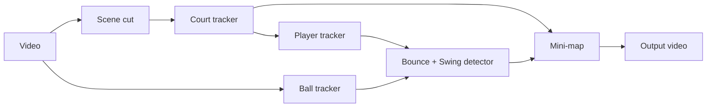

# Tennis Analysis

Analyze broadcast tennis video: detect the court, players, ball, bounce points and hits, and render a top-down mini-map.

<!-- Replace with your demo GIF: -->
<!--  -->

## Features

- **Court**: KeypointRCNN predicts 14 court keypoints, refined with classical CV (Hough lines) and validated geometrically; tracked across camera motion with optical flow, and re-detected in a background thread when needed.
- **Players**: YOLO-pose on a crop around the court; `PlayerMemory` keeps exactly one player per half of the court.
- **Ball**: local search (ROI) around the previous position, with a full-frame fallback.
- **Bounces**: detected from the ball trajectory, rejecting "fake bounces" caused by hits.
- **Swings**: detected from wrist motion relative to the torso (YOLO-pose keypoints).
- **Scene changes**: cut / dissolve / court loss, automatically resetting the trackers.
- **Mini-map**: player positions, ball, X marks for bounce points, and a HIT marker.
- Optional **TensorRT FP16** acceleration.

## Pipeline



## Installation

```bash
git clone https://github.com/<your-username>/tennis-analysis.git
cd tennis-analysis
python -m venv .venv && source .venv/bin/activate   # Windows: .venv\Scripts\activate
pip install -r requirements.txt
```

Install `torch` with the CUDA build matching your machine (see pytorch.org). Download the weights as described in [weights/README.md](weights/README.md).

## Usage

```bash
python main.py --input path/to/video.mp4
python main.py --input video.mp4 --output out.mp4 --no-preview --max-frames 500
```

Press `q` in the preview window to quit. Set `DEBUG_MODE = True` in `config.py` to draw extra boxes and print the reason each bounce candidate was rejected.

## Configuration

All constants live in `config.py`, with comments on how to tune them. The most commonly adjusted ones:

| Parameter | Meaning |
|-----------|---------|
| `BALL_LOCAL_CONF` / `BALL_GLOBAL_CONF` | ball confidence thresholds |
| `BOUNCE_MIN_DROP_PX`, `BOUNCE_MIN_DVY_PX` | bounce detection sensitivity |
| `SWING_SPEED_H_PER_S` | wrist speed threshold that counts as a racket swing |
| `HIT_SIDE_EXCL_S` | how long bounces are rejected on the half of the player who just hit |

## TensorRT acceleration (optional)

Requires an NVIDIA GPU and `pip install tensorrt`.

1. `python measure_person_crop.py <video>` to measure the crop size, then set `PERSON_ENGINE_IMGSZ` in `config.py`.
2. Adjust the `EXPORT_*` flags in `export_engines.py` and run `python export_engines.py`.
3. Turn on `USE_TENSORRT_BALL`, `USE_TENSORRT_PERSON` and `USE_BALL_LOCAL_ENGINE` in `config.py`.

An engine is tied to the exact GPU and TensorRT version it was exported on; re-export after changing machines.

## Profiling

`python profile_bottleneck.py --video path/to/video.mp4` measures the time of every pipeline stage, reports spikes, and suggests what to optimize.

## Known limitations

- Designed for broadcast cameras looking from behind the baseline.
- The ball model sometimes mistakes small white spots on the court lines for the ball.
- The bounce/swing thresholds were tuned on the test video; other videos may need re-tuning.

## Credits

[Ultralytics YOLO](https://github.com/ultralytics/ultralytics) (AGPL-3.0), [torchvision](https://github.com/pytorch/vision), OpenCV. Also credit the dataset(s) used for training.

## License

Choose a license and add a `LICENSE` file (note that ultralytics is AGPL-3.0).
